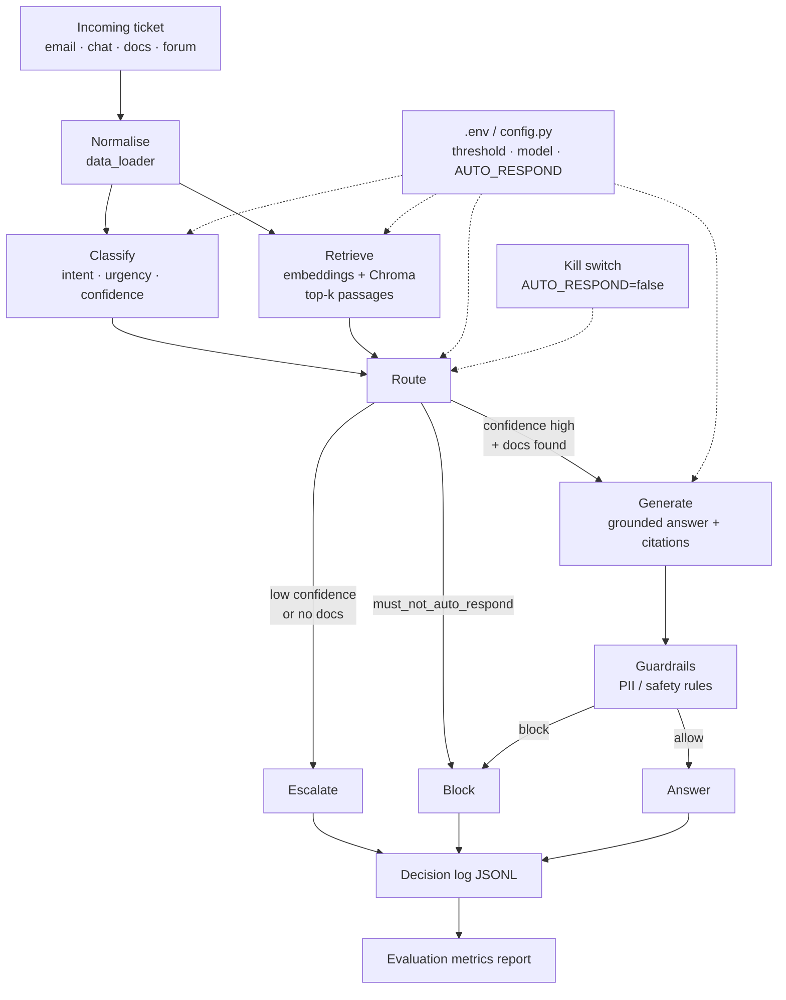

# CloudServe Capstone – Intelligent Customer Support System

Forward Deployed AI Engineering Capstone Project  
An intelligent support system for CloudServe Solutions.

## Overview

This project builds a production-style customer support automation system that classifies tickets, retrieves relevant documentation, generates grounded answers with citations, applies guardrails, and logs every decision.

## Prerequisites

- Python 3.10 or higher
- Git

## Setup

1. Clone the repository
2. Create and activate a virtual environment:

    ```bash
   python -m venv .venv
   # Windows
   .venv\Scripts\activate
   # macOS / Linux
   source .venv/bin/activate
    ```

3. Install dependencies:

    ```bash
    python -m pip install --upgrade pip
    pip install -r requirements.txt
    ```

4. Create a .env file in the root and add your API key:

    ```bash
    # Windows
    copy .env.example .env
    # macOS / Linux
    cp .env.example .env

    GROQ_API_KEY=your_key_here(or OPENROUTER_API_KEY=...)
    ```

## Running the System

1. Place ticket and documentation JSON files in `data/`.
2. Build the retrieval index (first run only):

   ```bash
   python -c "from src.retriever import DocumentRetriever; DocumentRetriever().build_index()"
   ```
3. Process tickets via the evaluation harness (see below).


## Evaluation Harness

1. Single unattended command (Acceptance Criteria A9/A10):

    ```bash
    python -m scripts.run_evaluation --input data/validation_tickets.json --output outputs/validation_report.json 
    --threshold 0.65 ##optional
    ```

- Writes a metrics report to the given output path
- Appends one decision record per ticket to logs/decisions.jsonl
- Log entry count must match the number of tickets processed
    
## Kill Switch

- Set in .env (or environment):

    ```text
    AUTO_RESPOND=false
    ```

## Project Structure

-   ```text
    src/           # Application code (pipeline, classifier, retriever, generator, guardrails, logger)
    scripts/       # Evaluation harness and test helpers
    data/          # Tickets and documentation JSON
    logs/          # Decision log (JSONL)
    outputs/       # Evaluation reports
    tests/         # Tests
    ```

## Architecture overview

CloudServe’s support pipeline processes one ticket at a time and returns a single logged decision: **answer**, **escalate**, or **block**.

```text
Ticket (email / chat / docs / forum)
        │
        ▼
┌───────────────────┐
│  Normalise        │  data_loader → Ticket schema
└─────────┬─────────┘
          │
          ├──────────────────────┐
          ▼                      ▼
┌─────────────────┐    ┌─────────────────┐
│  Classify       │    │  Retrieve       │
│  intent/urgency │    │  top-k passages │
│  + confidence   │    │  from 29 docs   │
└─────────┬───────┘    └─────────┬───────┘
          │                      │
          └──────────┬───────────┘
                     ▼
            ┌─────────────────┐
            │  Route          │  threshold + retrieval + flags
            │  answer /       │
            │  escalate /     │
            │  block          │
            └─────────┬───────┘
                      │
           ┌──────────┼──────────┐
           ▼          │          ▼
    ┌────────────┐    │   ┌────────────┐
    │  Generate  │    │   │  (skip)    │
    │  answer +  │    │   │  escalate  │
    │  citations │    │   │  or block  │
    └─────┬──────┘    │   └─────┬──────┘
          │           │         │
          └─────┬─────┘─────────┘
                ▼
         ┌────────────┐
         │ Guardrails │  must_not_auto_respond + PII checks
         └─────┬──────┘
               ▼
         ┌────────────┐
         │ Decision   │  JSONL log (one line per ticket)
         │ Logger     │
         └─────┬──────┘
               ▼
         Final decision → metrics / evaluation report
```

**Mermaid (renders on GitHub):**



### Flow in plain language

1. **Ingest** – Any channel is mapped to one `Ticket` object.  
2. **Classify** – LLM returns intent, urgency, and confidence (constrained intent list).  
3. **Retrieve** – Local embeddings search the 29 knowledge-base articles.  
4. **Route** – Answer only if confidence ≥ threshold **and** docs exist; otherwise escalate. Hard flags (e.g. `must_not_auto_respond`) block.  
5. **Generate** – Answer uses **only** retrieved passages and must include citations.  
6. **Guardrails** – Rule-based checks can still block before send.  
7. **Log** – Every decision is written to `logs/decisions.jsonl` for audit.  
8. **Kill switch** – `AUTO_RESPOND=false` forces all tickets to escalate immediately.

### Design choices (short)

| Choice | Why |
|--------|-----|
| Prefer escalate over invent | Stakeholder preference for safety over coverage |
| Citations required | Trust and auditability |
| Local embeddings + free-tier LLM | No paid dependency; clean checkout |
| Single `.env` config | One place to tune threshold, model, kill switch |
| Decision log always on | Reconstruct any automated reply later |

### Key modules

| Module | Role |
|--------|------|
| `src/config.py` | Loads `.env` (key, model, threshold, top-k, kill switch) |
| `src/pipeline.py` | End-to-end orchestration |
| `src/classifier.py` | Intent / urgency / confidence |
| `src/retriever.py` | Chunk, embed, search docs |
| `src/router.py` | Answer / escalate / block |
| `src/generator.py` | Grounded answer + citations |
| `src/guardrails.py` | Safety blocks |
| `src/decision_logger.py` | JSONL audit trail |
| `scripts/run_evaluation.py` | Unattended full-set run |

## Notes

- Embeddings use the local model all-MiniLM-L6-v2
- LLM access is configured via environment variables (free-tier providers only)
- No credentials are stored in the repository